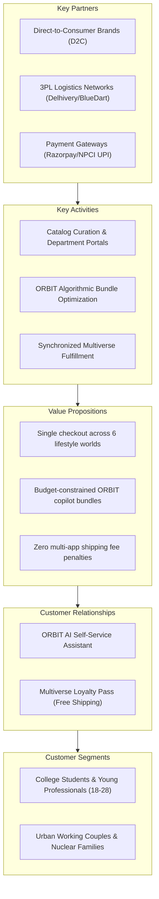

# BLOWMAGGY — Business Model & Monetization Strategy (BUSINESS_MODEL)

**Document Version:** 1.0.0  
**Target Market:** India Tier-1 & Tier-2 Digital Commerce Ecosystem  
**Model Framework:** Hybrid Marketplace with Direct Curated Inventory Lines  

---

## 1. Executive Business Thesis
Traditional e-commerce platforms in India are either hyper-verticalized (e.g., Nykaa for beauty, Myntra for fashion, Blinkit/Zepto for 10-minute grocery) or massive uncurated generalist marketplaces (Amazon India, Flipkart). 

**BLOWMAGGY** captures the high-margin, high-discovery sweet spot: a **Curated Multiverse Marketplace** where shoppers assemble cross-department lifestyle baskets in a single checkout. By raising Average Order Value (AOV) and consolidating shipping logistics into a single box, BLOWMAGGY dramatically improves contribution economics.

---

## 2. Business Model Canvas

---

## 3. Revenue Streams Evaluation

BLOWMAGGY operates as a **Hybrid Model** (inventory ownership for high-frequency daily groceries and core fashion essentials, coupled with an open marketplace commission model for high-ticket electronics and designer furniture):

1. **Marketplace Commission on Third-Party Sellers:** 
   * *Electronics & Gadgets:* 6% – 10%
   * *Fashion Apparel & Streetwear:* 18% – 25%
   * *Beauty & Personal Care:* 15% – 22%
   * *Home & Decor:* 15% – 20%
2. **Direct Product Sales Margin (First-Party Private Label):**
   * BLOWMAGGY "Dailyverse" staples and "Sanctuary" basics yield **35% – 50% gross product margin**.
3. **Sponsored Multiverse Placement & Brand Spotlights:**
   * Brands bid for prime positioning in ORBIT recommendation slots and Department Portal landing banners (disclosed transparently as sponsored).
4. **BLOWMAGGY Multiverse Pass (Subscription Membership):**
   * ₹999/year subscription offering guaranteed free express delivery, early drop access for Runway streetwear, and exclusive ORBIT budget bundles.

---

## 4. Illustrative Unit Economics (India Market Model)

The table below illustrates a representative cross-category order generated via the **ORBIT College Student Starter Kit** combining products across Fashion, Electronics, and Grocery:

### Illustrative Basket Composition
* *Fashion:* 1x Midnight Gradient Oversized Tee — ₹1,299
* *Electronics:* 1x GaN 65W Fast USB-C Charger — ₹1,999
* *Grocery:* 1x Dark Chocolate Almond Clusters — ₹299
* **Aggregate Basket Gross Order Value (AOV):** **₹3,597.00**

### Contribution Margin Waterfall (All Figures in INR)

| Revenue / Cost Line Item | Formula / Assumption | Amount (₹) | % of AOV |
| :--- | :--- | :--- | :--- |
| **Gross Merchandise Value (GMV)** | Basket checkout total | **₹3,597.00** | **100.0%** |
| Less: GST Remittance | 18% Blended GST | -₹548.70 | -15.2% |
| **Net Revenue (GMV Excl. Tax)** | Net order proceeds | **₹3,048.30** | **84.8%** |
| Less: Cost of Goods Sold / Seller Payout | Blended 65% cost of goods | -₹1,981.40 | -55.1% |
| **Gross Margin** | Net Revenue minus COGS | **₹1,066.90** | **29.7%** |
| Less: Payment Gateway Fee | Blended UPI (0%) + Cards (1.8%) = 1.0% | -₹35.97 | -1.0% |
| Less: Consolidated Single-Box Fulfillment | Pick, pack, and single 3PL surface shipment | -₹140.00 | -3.9% |
| Less: Returns & RTO Allowance | 6% blended return reserve | -₹215.82 | -6.0% |
| Less: Direct Customer Acquisition Cost (CAC) | Blended organic + paid acquisition amortized | -₹380.00 | -10.6% |
| **Contribution Margin 1 (CM1)** | Order profit before fixed overhead | **+₹295.11** | **+8.2%** |

### Why Cross-Department Baskets Transform Unit Economics
* **The Single-Category Flaw:** If the customer had purchased the ₹299 Dark Chocolate Almonds on a separate grocery app, fulfillment costs (₹90) and CAC (₹150) would result in a **negative contribution margin (-₹120)**.
* **The Multiverse Superpower:** By piggybacking the low-ticket grocery item into the high-ticket electronics order (₹1,999), the incremental fulfillment cost is merely ₹25 for the larger box, turning an unprofitable single item into a **profitable, high-retention cross-basket transaction**.

---

## 5. Strategic Risks & Validation Experiments

| Risk Hypothesis | Potential Impact | Validation Experiment |
| :--- | :--- | :--- |
| **Split-Shipment Reality** | If 3P merchants ship from separate warehouses, fulfillment costs triple. | Pilot BLOWMAGGY cross-dock fulfillment hubs in Bangalore and Delhi to aggregate goods before customer dispatch. |
| **Return Disproportion** | High fashion returns (25% industry average) dragging down electronics margin. | Enforce separate return return-to-origin policies per department with instant exchange credits. |
| **ORBIT Trust Friction** | Shoppers ignoring automated AI bundle recommendations. | A/B test ORBIT budget slider vs manual category browsing to measure cart conversion lift. |
