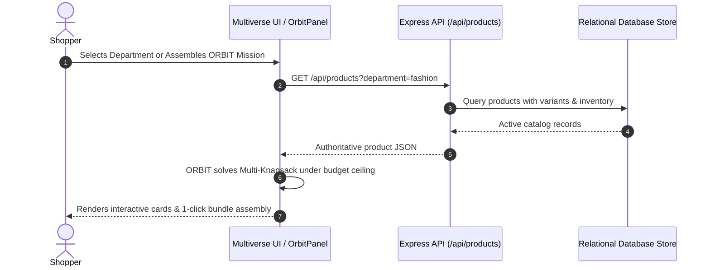
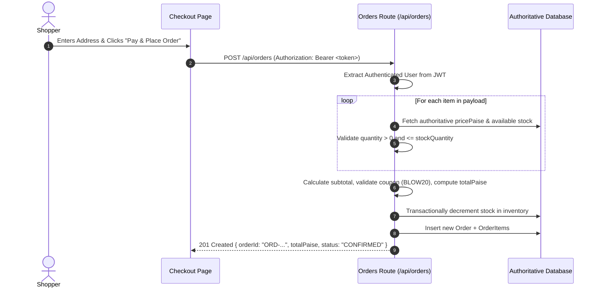
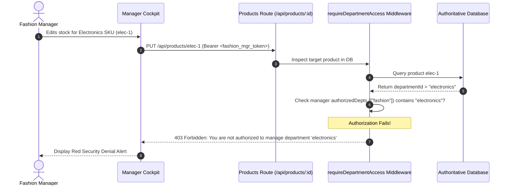
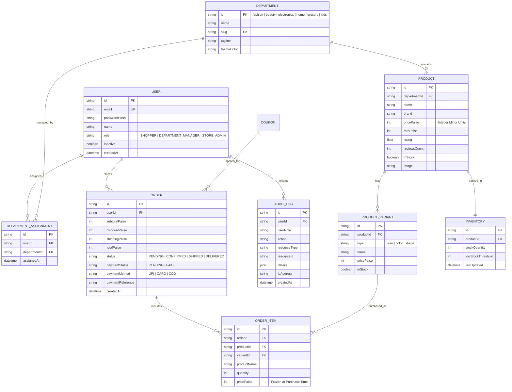

# BLOWMAGGY — Architecture & Design Document

**Document Version:** 2.0.0  
**Status:** Living Engineering Specification & RBAC Authorization Architecture  
**System Classification:** Decoupled Full-Stack Multi-Department Commerce Platform  
**Backend:** Node.js Express 5 REST API (`server/`)  
**Database:** Relational Model with Atomic Disk Persistence (`.data/blowmaggy.db.json`)  
**Client:** React 19 + Vite 6 Single Page Application (`src/`)  

---

## 1. System Overview

BLOWMAGGY is engineered as a decoupled, high-performance web architecture combining an **Editorial Multiverse Frontend**, an **Algorithmic Shopping Copilot (ORBIT)**, a dedicated **Department Manager Cockpit**, and a platform-wide **Store Admin Command Center**.

The platform treats catalog pricing with strict financial discipline using **integer minor units (paise)** to eliminate IEEE-754 floating-point drift. All cross-department bundle combinations, cart mutations, inventory adjustments, and order placements are validated server-side by the backend API.

---

## 2. System Architecture & Trust Boundaries

```
[ UNTRUSTED CLIENT ENVIRONMENT: BROWSER ]
┌────────────────────────────────────────────────────────────────────────┐
│  Shopper Multiverse (6 Worlds) │ Manager Cockpit │ Store Admin Cockpit │
└────────────────────────────────────┬───────────────────────────────────┘
                                     │ HTTPS / JSON (JWT Bearer Token)
═════════════════════════════════════╪═════════════════════════════════════
[ TRUST BOUNDARY: API GATEWAY & SECURITY PERIMETER (Express 5 :4000) ]
                                     │
                 ┌───────────────────┴───────────────────┐
                 ▼                                       ▼
        [Rate Limiter & CORS]               [Input Validation Schemas]
                 │                                       │
                 └───────────────────┬───────────────────┘
                                     ▼
                   [JWT Authentication Middleware (auth.js)]
                     • Token Signature Verification
                     • Deactivated User Immediate Check (401)
                                     │
                                     ▼
                    [RBAC Authorization Layer (rbac.js)]
                     • Role Verification (requireRole)
                     • Department Ownership Lookup (requireDepartmentAccess)
                     • Request Body Spoofing Prevention
                                     │
═════════════════════════════════════╪═════════════════════════════════════
[ TRUSTED CORE BUSINESS LOGIC & COMMERCE ENGINES ]
                                     │
         ┌───────────────────────────┼───────────────────────────┐
         ▼                           ▼                           ▼
  [Products API]              [Orders API]                [Admin & Manager]
  • Catalog Filtering         • Server-Side Pricing       • Dept KPIs
  • Variant Resolver          • Stock Atomic Decrement    • Manager Provisioning
  • Dept Scoped Mutations     • Demo Payment Signature    • Append Audit Logs
         │                           │                           │
═════════════════════════════════════╪═════════════════════════════════════
[ PERSISTENT RELATIONAL DATA LAYER (.data/blowmaggy.db.json) ]
  • users             • departments               • department_assignments
  • products          • product_variants          • inventory
  • orders            • order_items               • audit_logs
```

---

## 3. Data-Flow & Authorization Diagrams

### A. Browsing & ORBIT Cross-Department Flow


### B. Transactional Order Placement & Server Validation Flow


### C. Department Manager Scoped Mutation with Anti-Spoofing


---

## 4. Entity Relationship Diagram (ERD)



---

## 5. Security & Authorization Architecture

### A. Role Definitions & Trust Hierarchies
1. **SHOPPER:** Unprivileged consumers. May read products, assemble carts, manage their own wishlists, place orders, and view only their own orders (`/api/orders/mine`).
2. **DEPARTMENT_MANAGER:** Authorized category managers. Explicitly assigned to 1 or more departments via `department_assignments`. Can create and update products only within their assigned department. Blocked from other departments, admin metrics, and manager account provisioning.
3. **STORE_ADMIN:** Platform-wide administrative operator. Can manage catalog records across all 6 departments, provision and deactivate manager accounts, configure global promotions, and review immutable audit logs.

### B. Ten Critical Authorization Verification Rules
1. Shoppers cannot create, update, or delete products.
2. Shoppers cannot access Store Admin endpoints.
3. Department Managers can update products in their assigned department.
4. Department Managers cannot update products in another department.
5. Department Managers cannot assign themselves the Store Admin role.
6. Store Admins can manage permitted resources across all departments.
7. Shoppers cannot read another Shopper's orders.
8. Changing a URL or request body cannot bypass department permissions.
9. Unauthenticated requests cannot access protected resources.
10. Deactivated accounts lose access immediately upon status check.
